# Time-Series Anomaly Detection Pipeline

A modular, end-to-end anomaly detection system for multivariate time-series data, made using the NASA SMAP/MSL dataset. Trained on three detectors: statistical, tree-based, and sequence-aware, and evaluated with point-adjusted F1 (the standard benchmark metric), and exposed via a REST API (uvicorn) and an interactive Streamlit dashboard.

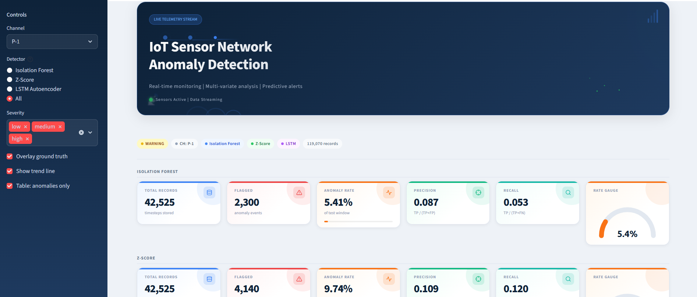

---

## What it aims to solve:

Anomaly detection on continuous sensor streams is a core problem in domains ranging from spacecraft telemetry to optical network monitoring. This project implements and compares three methodologically distinct approaches on a real-world benchmark dataset to understand the tradeoffs between simplicity, interpretability, and temporal awareness.

---

## Architecture

```
┌─────────────────────────────────────────────────────────────┐
│                         Pipeline                            │
│                                                             │
│   SMAP/MSL .npy  →  Ingestion  →  Detection  →  Storage    │
│                                        │                    │
│                          ┌─────────────┼──────────────┐     │
│                          ▼             ▼              ▼     │
│                    Isolation      Z-Score         LSTM      │
│                    Forest         (rolling)   Autoencoder   │
│                          └─────────────┼──────────────┘     │
│                                        ▼                    │
│                                   PostgreSQL                │
│                                        │                    │
│                          ┌─────────────┴──────────┐        │
│                          ▼                         ▼        │
│                      FastAPI                  Streamlit     │
│                    REST API                  Dashboard      │
└─────────────────────────────────────────────────────────────┘
```

| Module | Description |
|---|---|
| `ingestion/` | Loads SMAP/MSL `.npy` splits, streams data in configurable batches |
| `detection/` | Three detectors + point-adjusted evaluation metrics |
| `storage/` | SQLAlchemy ORM, PostgreSQL writer with batch commits |
| `api/` | FastAPI REST endpoints for querying results |
| `app/` | Streamlit dashboard with live charts and benchmark comparison |
| `main.py` | Pipeline orchestrator — trains, detects, stores, evaluates |

---

## Detectors

### 1. Isolation Forest
A tree-based ensemble that isolates anomalies by recursively partitioning the feature space. It treats each timestep as an independent multivariate point. That makes it fast to train and accurate at detecting point anomalies and multivariate outliers with no distributional assumptions.

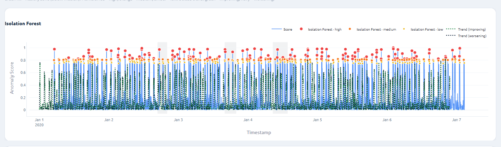

**Weakness:** No concept of temporal order. An anomaly visible only as a deviation from the expected *sequence* will be missed.

### 2. Z-Score (Rolling Window)
A statistical baseline. It computes a rolling mean and standard deviation over a configurable window, and flags any point whose Z-score exceeds a threshold. This makes it simple, interpretable, and effective for univariate spikes. Each feature is scored independently.

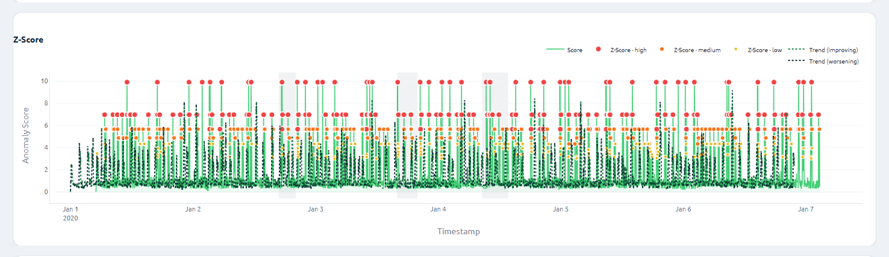

**Weakness:** As it is univariate, it misses anomalies that only appear as unusual *combinations* of features.

### 3. LSTM Autoencoder
A sequence-to-sequence model trained to reconstruct normal windows of sensor data. At inference, timesteps with high reconstruction error (above the 99.5th percentile of training errors) are flagged as anomalies. The model learns the temporal structure, expected transitions, periodicities, and inter-feature dependencies. This makes it aware of gradual drifts and contextual anomalies invisible to the other two methods.

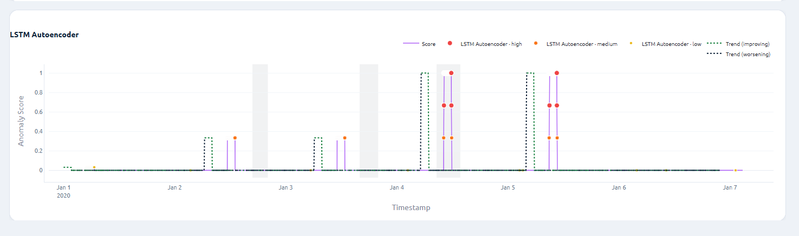

**Architecture:**
```
Encoder: 2-layer LSTM  (n_features → hidden_dim=64)
Decoder: 2-layer LSTM  (context vector → hidden_dim=64)
Output:  Linear layer  (hidden_dim → n_features)
```

Trained on normal (training-split) data only. Reconstruction error is assigned to the last timestep of each sliding window (online detection setting). Model weights are cached to disk so the pipeline skips retraining on subsequent runs.

---

## Optimizations
The following optimization technique were applied:

### 1. LSTM Model caching
The trained model is saved to data/lstm_{channel}.pt and reloads on subsequent runs instead of retraining on the entire data. Training lasts 2 - 5 minutes on CPU. To force a retrain (e.g. after changing hyperparameters), delete the cached file: rm data/lstm_{channel}.pt


### 2. Streamlit
@st.cache_data and @st.cache_resource, the DB engine, and the query results are cached so the dashboard does not re-query PostgreSQL on every run.

### 3. Batch DB writes
The results are saved as configurable batches (default 500 rows) instead of one row at a time.

### 4. Training Window Stride
The LSTM uses train_step=10 during training, sampling windows every 10 timesteps instead of 1 reduces the number of training windows by 10x without significantly impacting model performance.

## Evaluation Protocol

Raw precision/recall is misleading on SMAP/MSL because anomalies appear in contiguous multi-timestep segments. A detector that fires once inside a 50-timestep anomaly window correctly identified the fault, but raw metrics penalise the other 49 un-flagged points.

This project implements **point-adjusted F1** (Xu et al., 2018), which is the standard evaluation protocol in the anomaly detection literature:

> If any predicted point falls inside a contiguous ground-truth anomaly segment, all points in that segment are counted as correctly detected.

Both raw and point-adjusted metrics are logged at the end of every pipeline run and displayed in the dashboard's benchmark table.

**Results on channel P-1 (SMAP):**

| Detector | PA-F1  | PA-Precision | PA-Recall | Raw F1 | Raw Precision | Raw Recall |
|---|---|---|---|---|---|---|
| Isolation Forest | **0.787** | 0.650 | 1.000 | 0.099 | 0.129 | 0.080 |
| Z-Score | 0.684 | 0.544 | 1.000 | 0.160 | 0.160 | 0.160 |
| LSTM Autoencoder | 0.372 | 0.339 | 0.411 | 0.144 | 0.148 | 0.140 |

Isolation Forest achieves the highest PA-F1 on this channel, driven by perfect PA-Recall — it catches every anomaly segment. Z-Score also achieves perfect PA-Recall with simpler univariate statistics. The LSTM Autoencoder's lower PA-F1 reflects that P-1 contains mostly point anomalies where temporal context adds less signal. 

### Isolation Forest Sensitivity Analysis (`IF_CONTAMINATION`)

The actual anomaly rate in P-1 is **8.83%**. A sensitivity sweep over `IF_CONTAMINATION` shows that lower values consistently improve PA-F1 — the model flags fewer points, but the point-adjust protocol credits full segment detection regardless:

| Contamination | PA-F1 | PA-Precision | PA-Recall | Raw F1 |
|---|---|---|---|---|
| 0.01 | **0.942** | 0.891 | 1.000 | 0.019 |
| 0.03 | 0.853 | 0.744 | 1.000 | 0.046 |
| 0.05 | 0.781 | 0.641 | 1.000 | 0.064 |
| 0.07 | 0.728 | 0.572 | 1.000 | 0.085 |
| 0.10 | 0.646 | 0.477 | 1.000 | 0.093 |
| 0.15 | 0.556 | 0.385 | 1.000 | 0.117 |
| 0.20 | 0.485 | 0.320 | 1.000 | 0.127 |

`IF_CONTAMINATION=0.01` is used as the default. The sweep script is at `scripts/tune_contamination.py`.
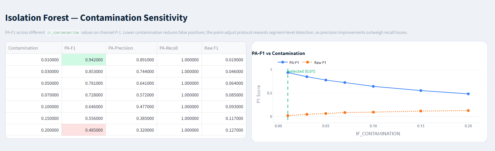

---

## Dataset

**NASA SMAP/MSL** — Soil Moisture Active Passive (SMAP) satellite and Mars Science Laboratory (MSL) rover telemetry, released by NASA JPL.

- 55 channels (SMAP) + 27 channels (MSL)
- Each channel: multivariate time-series with 25 features
- Pre-split into train (anomaly-free) and test (with ground-truth labels)
- Download: [NASA SMAP/MSL Dataset - Kaggle](https://www.kaggle.com/datasets/patrickfleith/nasa-anomaly-detection-dataset-smap-msl?resource=download)

Place the data under `data/` as:
```
data/
  train/
    P-1.npy
    S-1.npy
    ...
  test/
    P-1.npy
    S-1.npy
    ...
  labeled_anomalies.csv
```

---

## Quick Start

### Local

```bash
# 1. Clone and install dependencies
git clone https://github.com/imann128/iot-anomaly-detection.git
cd iot-anomaly-detection

pip install -r requirements.txt

# 2. Configure environment
cp .env.example .env
# Edit .env: set DATABASE_URL and CHANNEL

# 3. Start PostgreSQL (or use Docker just for the DB)
docker run -d \
  --name pg \
  -e POSTGRES_DB=iot_anomaly \
  -e POSTGRES_USER={YOUR_USER} \
  -e POSTGRES_PASSWORD={YOUR_PASSWORD} \
  -p 5432:5432 \
  postgres:15

# 4. Run the pipeline (trains detectors, writes results to DB)
python main.py

# 5. Start the API
uvicorn api.routes:app --reload --port 8000

# 6. Start the dashboard
streamlit run app/dashboard.py
```

Dashboard: [http://localhost:8501](http://localhost:8501)  
API docs: [http://localhost:8000/docs](http://localhost:8000/docs)

### Docker Compose

```bash
docker compose up --build
```

All three services (pipeline, API, dashboard) start automatically. The LSTM model is cached under `data/` which is volume-mounted, so it persists across container restarts.

---

## Configuration

All parameters are set via environment variables (or `.env`):

| Variable | Default | Description |
|---|---|---|
| `DATABASE_URL` | — | PostgreSQL connection string |
| `CHANNEL` | `P-1` | SMAP/MSL channel to process |
| `BATCH_SIZE` | `500` | DB write batch size |
| `IF_CONTAMINATION` | `0.01` | Expected anomaly fraction for Isolation Forest (tuned) |
| `ZSCORE_WINDOW` | `100` | Rolling window length (timesteps) |
| `ZSCORE_THRESHOLD` | `3.0` | Z-score flag threshold |
| `LSTM_MODEL_DIR` | `data` | Directory to cache trained LSTM weights |

---

## API Reference

| Endpoint | Description |
|---|---|
| `GET /health` | Liveness check |
| `GET /channels` | List channels present in the database |
| `GET /anomalies` | Paginated anomaly records with filtering by channel, detector, severity |
| `GET /anomalies/{id}` | Single record by primary key |
| `GET /stats` | Aggregate counts, anomaly rate, precision, recall |
| `GET /comparison/{channel}` | Side-by-side detector stats for a channel |

Full interactive docs at `/docs` (Swagger UI). The /docs endpoint provides an interactive Swagger UI where you can query anomaly records, test filters by channel, detector, and severity, and inspect individual flagged timesteps, all without writing any code. It's useful for spot-checking pipeline output before building on top of the API.

---

## Dashboard

The Streamlit dashboard is interactive. Select a detector (or view all three), filter by severity, and toggle trend overlays. It provides:

- **KPI cards** — Total Records, Flagged, Anomaly Rate, Precision, Recall, and Rate Gauge
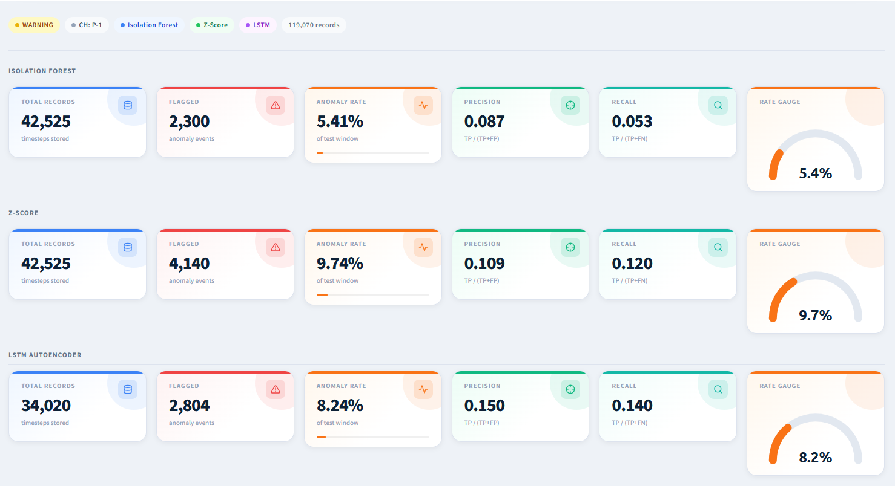
- **Time-series charts** — anomaly scores over the test window with severity markers
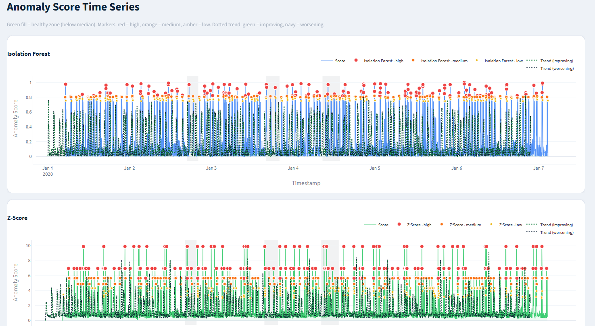

- **Score distribution** — histogram of anomaly scores per detector where a right-skewed distribution with a long tail indicates the detector is assigning high scores to a small subset of timesteps, as expected.
- **Benchmark results table** — PA-F1, PA-Precision, PA-Recall, Raw F1, Raw Precision, Raw Recall for all three detectors
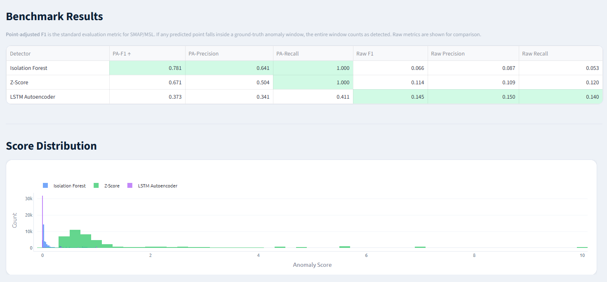

- **Severity breakdown** — A bar chart of low/medium/high severity counts per detector. It shows not just how many anomalies each detector flags but how confidently it flags them
- **Flagged Results** - table of all flagged timesteps, filterable by detector and severity. It is useful for inspecting individual anomalies and their scores.
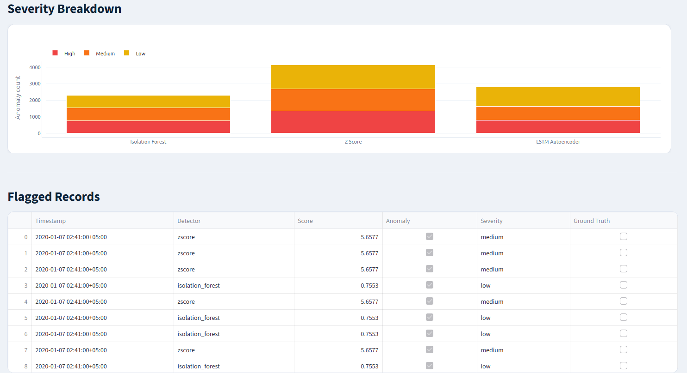

- **Detector agreement** — overlap analysis across all three detectors. It shows how often detectors agree or fire independently. Timesteps flagged by all three are highest-confidence anomalies; unique flags expose each method's blind spot.
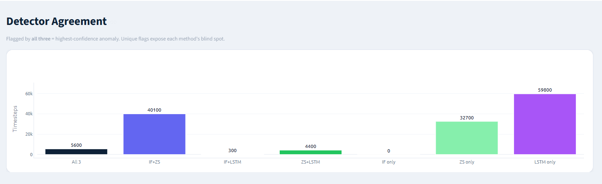

- **Sensitivity analysis** — PA-F1 vs `IF_CONTAMINATION` sweep with chart, showing why 0.01 was selected

---

## Project Structure

```
.
├── main.py                   # Pipeline entry point
├── requirements.txt
├── Dockerfile
├── docker-compose.yml
├── .env.example
│
├── ingestion/
│   ├── loader.py             # SMAP/MSL .npy loader
│   └── simulator.py         # Batch streaming iterator
│
├── scripts/
│   └── tune_contamination.py # IF_CONTAMINATION sensitivity sweep
│
├── tests/
│   ├── test_metrics.py       # Unit tests for point-adjusted F1 protocol
│   └── test_detectors.py     # Smoke tests for all three detectors
│
├── detection/
│   ├── isolation_forest.py   # Isolation Forest detector
│   ├── zscore.py             # Rolling Z-Score detector
│   ├── lstm_detector.py      # LSTM Autoencoder detector
│   └── metrics.py            # Point-adjusted F1 evaluation
│
├── storage/
│   ├── db.py                 # SQLAlchemy models and engine
│   └── writer.py             # Batch DB writer
│
├── api/
│   └── routes.py             # FastAPI endpoints
│
└── app/
    └── dashboard.py          # Streamlit dashboard
```

---

## Testing

```bash
pip install pytest
pytest tests/ -v
```

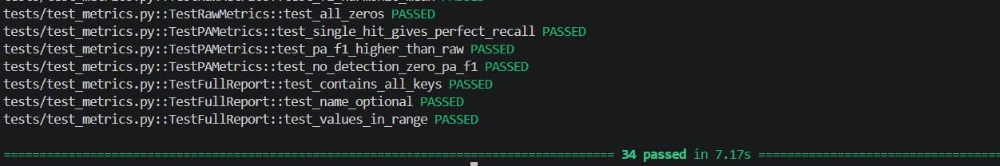

The test suite covers two modules with 34 tests total:

**`tests/test_metrics.py`** — unit tests for the point-adjusted F1 protocol, which is the most critical logic in the pipeline. A silent bug here would corrupt all benchmark numbers without raising an error. Tests cover:
- A single detection inside a segment credits the entire segment
- A segment with zero detections is not credited
- False positives outside anomaly segments are preserved unchanged
- Multiple independent segments are each handled correctly
- Anomaly segments at the start and end of the series (boundary conditions)
- Perfect predictions, all false negatives, all false positives
- Output dtype is always `int8`
- All metric values are in the valid range `[0, 1]`

**`tests/test_detectors.py`** — smoke tests for all three detectors verifying the fit/predict contract on synthetic data. Tests cover:
- Output shapes match input length for all three detectors
- Predictions are strictly binary (0 or 1), never any other value
- Severity labels are always one of `normal`, `low`, `medium`, `high`
- Anomaly scores are non-negative and normalised to `[0, 1]` for Isolation Forest
- `RuntimeError` is raised if `predict()` is called before `fit()`
- Higher `IF_CONTAMINATION` produces a higher anomaly rate as expected
- An injected spike in a constant series is correctly flagged by Z-Score
- A constant series produces no anomaly flags
- LSTM save/load round-trip preserves the anomaly threshold exactly
- Loaded LSTM model produces identical predictions to the original

---

## References

- Hundman et al. (2018). *Detecting Spacecraft Anomalies Using LSTMs and Nonparametric Dynamic Thresholding*. KDD 2018. [[paper]](https://arxiv.org/abs/1802.04431)
- Xu et al. (2018). *Unsupervised Anomaly Detection via Variational Auto-Encoder for Seasonal KPIs in Web Applications*. WWW 2018. *(Point-adjust protocol)*
- Liu et al. (2008). *Isolation Forest*. ICDM 2008.
